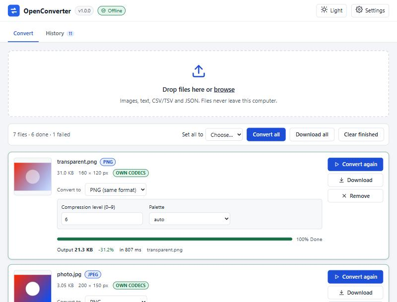
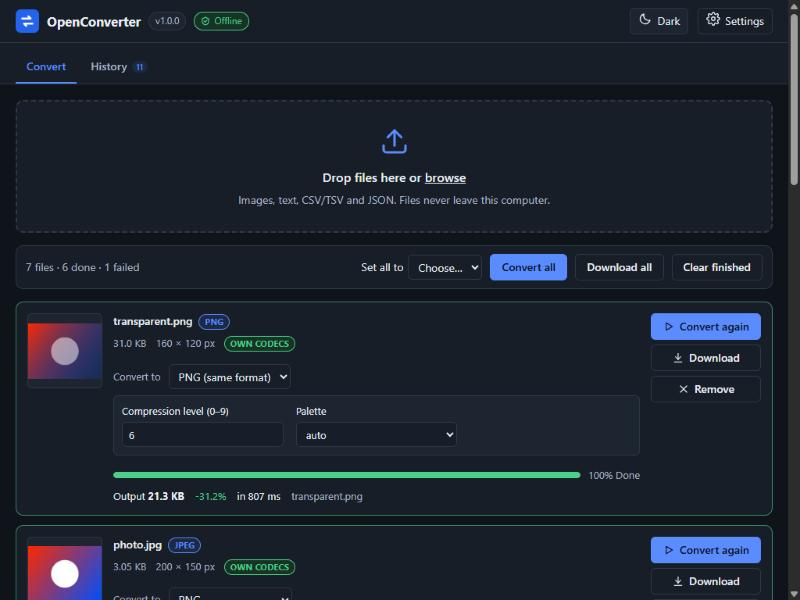
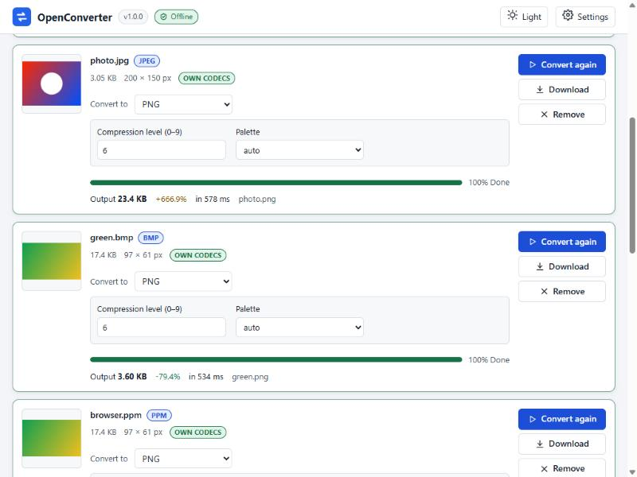
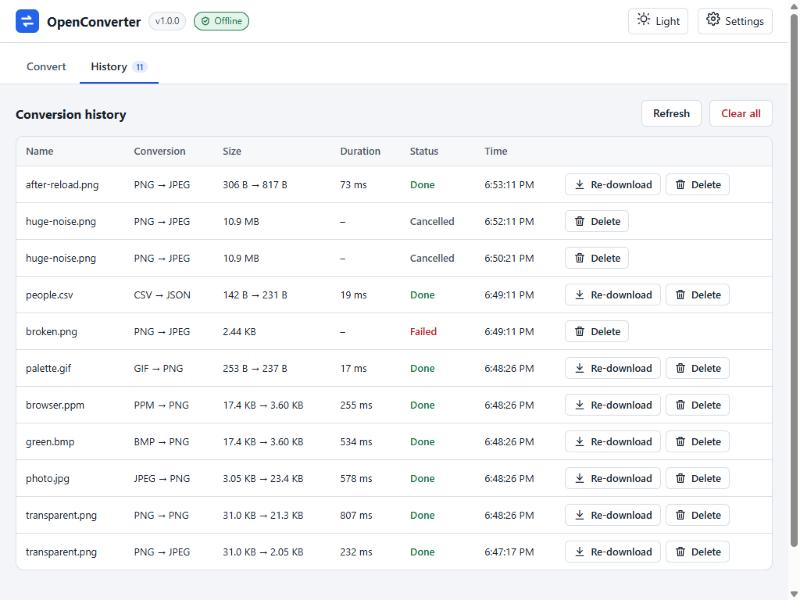

# OpenConverter

**Convert anything. Keep everything local.**

OpenConverter is a free, open-source file converter that runs entirely on your
own computer. Version 1.0 handles images, plain text and tabular data, using
codecs written from scratch on the Python standard library: no packages to
install, no build step, no internet connection.



## Privacy promise

* **Local only** – the server listens on `127.0.0.1` and your files never leave the machine.
* **Offline** – no CDNs, web fonts, remote images, update checks or external APIs.
* **No telemetry** – nothing is collected or sent anywhere.

| Dark theme | Finished conversions | History |
|---|---|---|
|  |  |  |

## Supported formats

| Format | Read | Write | Ownership |
|---|---|---|---|
| PNG | ✅ all colour types and depths, Adam7 | ✅ adaptive filters, palette, 16-bit | **OWN** |
| JPEG (baseline) | ✅ any sampling, restart markers, EXIF orientation | ✅ quality 1–100, 4:2:0 / 4:4:4, optimal Huffman | **OWN** |
| GIF | ✅ first frame, transparency, interlacing | – | **OWN** |
| BMP | ✅ 1–32-bit, RLE4/8, bit fields, OS/2, V4/V5 | ✅ 24-bit / 32-bit with alpha | **OWN** |
| TGA | ✅ colour-mapped, true-colour, grey, RLE | ✅ uncompressed or RLE | **OWN** |
| QOI | ✅ | ✅ | **OWN** |
| PBM / PGM / PPM | ✅ ASCII and binary, up to 16-bit | ✅ | **OWN** |
| CSV / TSV | ✅ RFC 4180 | ✅ | **OWN** |
| JSON (tables) | ✅ arrays of objects or arrays | ✅ | **PARTIAL** stdlib `json` for syntax |
| TXT | ✅ UTF-8/16 (± BOM), Latin-1, Windows-1252 | ✅ | **PARTIAL** Python text codecs |

*OWN* = implemented in this repository (including DEFLATE, CRC-32, Adler-32
and LZW). *PARTIAL* = relies on a Python standard-library component.
Details, variants and conversion rules: [docs/FORMATS.md](docs/FORMATS.md).

## Requirements

Python **3.12 or newer**. Nothing else.

## Quick start

**Windows**

```powershell
git clone https://github.com/Yusuf6411/OpenConverter.git
cd OpenConverter
py -3 -m openconverter          # or: .\scripts\run.ps1
```

**Linux / macOS**

```bash
git clone https://github.com/Yusuf6411/OpenConverter.git
cd OpenConverter
python3 -m openconverter
```

Your browser opens `http://127.0.0.1:8080`. Drop files on the window, pick a
target format, and press **Convert**. Use `--port 9000` if 8080 is busy and
`--no-browser` to skip opening a browser. Stop the server with Ctrl+C.

## Command line

```bash
python -m openconverter                                   # serve (default)
python -m openconverter serve --port 9000 --no-browser
python -m openconverter convert in.png out.jpg --quality 85 --subsampling 4:2:0 --background "#ffffff"
python -m openconverter convert data.csv data.json --indent 2
python -m openconverter convert in.txt out.txt --to-encoding utf-16le --newline crlf
python -m openconverter formats [--json]
python -m openconverter --version
```

The source format is detected from the file's content; the target comes from
the output extension (or `--to`). Existing outputs are kept unless you pass
`--force`. Exit codes: `0` success, `1` conversion error, `2` usage error,
`130` interrupted.

## Where your data is stored

| OS | Folder |
|---|---|
| Windows | `%LOCALAPPDATA%\OpenConverter\` |
| Linux / macOS | `$XDG_DATA_HOME/openconverter` or `~/.local/share/openconverter/` |

It contains `uploads/`, `outputs/`, `temp/`, `logs/`, `settings.json` and
`history.jsonl` (metadata only: names, formats, sizes, timings). Uploaded and
converted files are deleted automatically after `retention_hours` (24 by
default). To remove everything, stop the server and delete the folder.
`--data-dir PATH` uses a different folder.

## Security notes

* By default the server binds to `127.0.0.1` only. `--host 0.0.0.0` (or any
  other address) makes it reachable from your network; the server prints a
  warning because anyone who can reach it could upload files and run
  conversions.
* Requests must name this server in the `Host` header (DNS-rebinding defence);
  state-changing requests need a same-origin `Origin` and an
  `X-OpenConverter: 1` header (CSRF defence).
* Every response carries a strict Content-Security-Policy; the web UI has no
  inline scripts or styles and never inserts file names as HTML.
* Uploads are stored under random names; decoders check size limits before
  allocating memory and guard against decompression bombs.

## Performance

The codecs are pure Python, so they are much slower than C libraries. On the
development laptop (Intel Core i5-1035G1, Python 3.14) a 1024×768 photo takes
1.5–2.5 s to encode or decode as JPEG and about 6 s to write as PNG at the
default level at full clock speed (3–4× longer when the laptop is power- or
heat-limited); 1920×1080 images take about 2.5× as long. Measured numbers
and the method are in [docs/FORMATS.md](docs/FORMATS.md#performance). The UI
warns before converting images over 4 megapixels, using timings measured on
your own machine.

## Running the tests

```bash
python -m unittest discover -s tests -v
python scripts/verify_release.py --ci
```

The suite needs no extra packages, uses temporary data folders and ephemeral
ports, and runs on Windows and Linux. `python scripts/make_fixtures.py`
regenerates the deterministic test images; `python scripts/bench.py` measures
performance.

## Project structure

```
openconverter/   server/ (HTTP, API, security, SSE) → core/ (registry, jobs, storage)
                 → converters/ → codecs/, ops/, models/
web/             index.html, css/, js/ (ES modules, no frameworks)
tests/           unit/, integration/, fixtures/ (unittest only)
scripts/         run.ps1, make_fixtures.py, bench.py, verify_release.py
docs/            ARCHITECTURE.md, FORMATS.md, API.md, PROGRESS.md, screenshots/
```

See [docs/ARCHITECTURE.md](docs/ARCHITECTURE.md) for the design and a
step-by-step guide to adding a format, and [docs/API.md](docs/API.md) for the
HTTP API.

## Roadmap

* **1.1** – progressive JPEG, GIF writing, WebP.
* **Later** – PDF text extraction, DOCX, WAV/FLAC, archives.

## Contributing

Issues and pull requests are welcome. Please keep the core rules: standard
library only, our own codecs, nothing that touches the network, typed errors
instead of broken output, and tests for every change
(`python -m unittest discover -s tests` must stay green with zero skips).

## License

[MIT](LICENSE) © 2026 Yusuf
